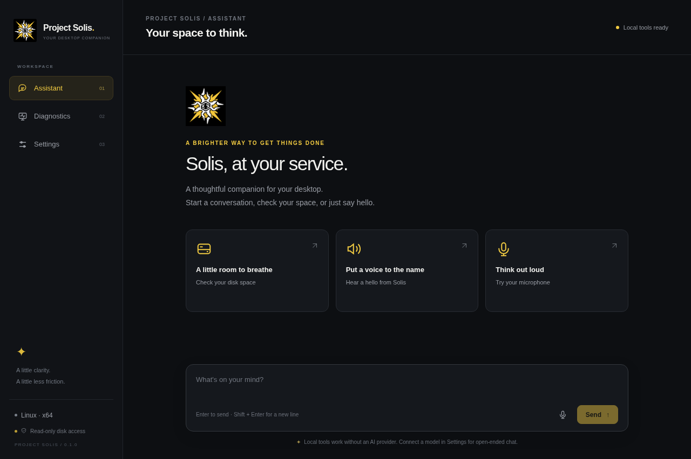

# Project Solis

Project Solis is a desktop assistant with a black, white, and yellow interface and the supplied Solis emblem. macOS is the first testing platform. It is a separate application alongside [QuickPlan](../README.md); the existing CAD project keeps its own build and files.

Solis starts with useful local tools: text chat, the computer's date and time, operating-system information, and read-only storage diagnostics. **The default local mode is not a language model.** It explains its limits and needs no AI account or model server. Connect Ollama or an OpenAI-compatible service in Settings for open-ended conversations.

Voice replies prefer a **female Colombian Spanish (`es-CO`) voice**. The app checks installed voice metadata and shows the voice actually selected. A matching voice depends on what your operating system provides; a Spanish voice from another region is reported as a fallback, not labelled Colombian.



## Run on your Mac

You need **macOS 13 or later**, **Node.js 24 or later** with npm, and **Xcode Command Line Tools**. You do not need to create an Xcode project. The command-line tools compile the small native speech helper automatically.

1. Download or clone this repository, then open **Terminal**.
2. Type `cd `, drag the repository's **solis-desktop** folder into Terminal, and press Return. This puts Terminal in this app's folder.
3. Check your tools:

   ```sh
   node --version
   npm --version
   xcode-select -p
   ```

   If Node is missing or older than 24, install a current Node.js LTS release from [nodejs.org](https://nodejs.org/). If the Xcode tools are missing, run `xcode-select --install` and finish Apple's installer.

4. Install the locked dependencies and open Solis:

   ```sh
   npm ci
   npm start
   ```

`npm start` prepares the macOS speech helper with `xcrun` before launching Electron. The first build can take a moment. Keep Terminal open while testing; press Control-C there to stop a development run.

If the helper fails to compile, check `xcode-select -p` and run `npm run prepare:macos` to see the compiler's error. The helper is built for the current Mac's architecture and a macOS 13 deployment target. Build on the destination architecture when preparing an Intel or Apple silicon app.

## First conversation and voice

Try **“What time is it?”** or **“How much free space do I have?”** in Assistant. A local reply identifies what it can verify. The microphone places recognized words in your message box so you can review them before sending.

In **Settings → Voice & listening**, leave the automatic voice choice selected or choose an installed voice. The default preference is female `es-CO`. Use **Hear a hello from Solis** on the welcome screen to test your speakers. The current native microphone recognizer uses English (`en-US`); the reply voice preference is separate from transcription.

To add system voices, open **System Settings → Accessibility → Read & Speak** or **Spoken Content**, depending on your macOS version, and manage the system voice list. Voice names and available languages vary by macOS version and installed downloads. Restart Solis after installing a voice, then inspect its language and fallback message in Settings. Solis cannot guarantee a Colombian accent when macOS has no matching voice installed.

The app requests microphone access only after you choose a microphone action or **Request access**. Native dictation also asks for Speech Recognition access. If you denied either permission, open:

- **System Settings → Privacy & Security → Microphone**
- **System Settings → Privacy & Security → Speech Recognition**

Enable Project Solis, then quit and reopen it. During development, macOS may identify the requesting process as Electron or Project Solis Speech instead. Test the packaged app too, because development and packaged applications can have different permission identities. Choose your input and output devices in **System Settings → Sound**.

Apple Speech uses on-device recognition when supported. Apple may process audio online when on-device recognition is unavailable. Browser recognition is an optional fallback and depends on the Electron build and speech service; typing remains available if recognition is unsupported. This is push-to-talk dictation, with no background wake-word listener.

## Connect a model when you want one

Open **Settings → Intelligence**, choose a provider, enter a model that is available to that provider, and save preferences. **Test connection** checks the server and its model list; send a message to verify an actual model reply.

| Provider | Example endpoint | What you need |
| --- | --- | --- |
| Built-in local tools | None | Nothing else installed; this is the default. |
| Ollama | `http://127.0.0.1:11434` | A running Ollama server and an installed model, such as `llama3.2`. |
| OpenAI-compatible API | `https://api.openai.com/v1` | A compatible service, its model name, and an API key when required. |

HTTP is accepted only for loopback servers on this computer. Remote endpoints require HTTPS. Endpoint URLs cannot contain embedded credentials, queries, or fragments. Messages sent to a model go to the endpoint you choose, under that service's privacy and billing terms.

Enter an API key in Settings, never in chat or in source code. Solis saves keys with Electron's OS-backed encryption (`safeStorage`; Keychain protection on macOS) and does not fall back to storing a plaintext key when secure storage is unavailable. Saved keys are not returned to the interface and are bound to the configured server origin. No model reply can run a command or request additional app permissions.

## Storage diagnostics stay read-only

Choose **Diagnostics → Check disk space** or ask about free storage in chat. The report includes filesystem capacity, available space, and the device or volume details the operating system exposes. macOS reports the system volume; Linux uses a bounded block-device inventory; Windows reports fixed logical volumes. It does not inspect personal files or calculate folder sizes. APFS shared space and permissions can make operating-system reports differ.

**Formatting, erasing, deleting, partitioning, repairing, and privileged disk operations are disabled.** There is no confirmation switch to enable them. Diagnostics use a fixed allowlist of read-only probes; chat text and model output cannot supply process arguments. Capacity and device information do not establish drive health: SMART and hardware health are not assessed.

## Develop and package

Run commands from `solis-desktop`:

```sh
npm ci
npm test
npm run test:ui
npm run pack
npm run dist
```

- `npm test` runs the Node test suite, including settings, assistant behavior, voice process handling, and read-only diagnostics.
- `npm run test:ui` launches Electron through Playwright for desktop interaction checks. Linux needs a display; in a headless environment use `xvfb-run -a npm run test:ui` with Xvfb and Electron's system libraries installed.
- `npm run pack` creates an unpacked application in `dist` for local testing.
- `npm run dist` creates the platform's distribution artifacts in `dist`. macOS packaging prepares and bundles the native speech helper automatically.

The build uses Electron 45.2.3, electron-builder 26.18.0, plist 5, and Playwright 1.64.1 with the lockfile controlling the exact dependency graph. Use `npm ci` for a reproducible install. macOS packaging targets macOS 13 or later. Packages produced without a developer's signing credentials are development artifacts; public distribution requires the appropriate platform signing and, for macOS, Apple notarization.

The native helper exposes only `--voices`, `--speak`, and `--listen`. Its build embeds `native/macos/SpeechInfo.plist` with microphone and Speech Recognition usage descriptions. `--voices` reads actual voice metadata; `--speak` reads a JSON request from standard input; only `--listen` requests recording permissions. It is not a shell or general command runner.

The [CI workflow template](docs/ci-workflow.yml.example) can install, test, and package on macOS, Windows, and Linux without publishing a release. To enable it, copy it to `.github/workflows/solis.yml` through a GitHub account with workflow write permission. It has not run remotely here. Cross-platform packaging and virtual UI tests cannot prove physical microphone capture, macOS privacy prompts, audible voice quality, or a Colombian accent. Those need testing on the actual Mac using [the macOS checklist](docs/MACOS_TESTING.md). A Linux cloud environment cannot verify those Mac hardware behaviors.

See the [validation record](docs/VALIDATION.md) for the checks completed in this development environment and the remaining Mac checks.

## Project layout

- `src/main`: Electron main process, encrypted preferences, assistant providers, system voice integration, and bounded read-only diagnostics.
- `src/renderer`: desktop interface and interaction code.
- `native/macos`: Apple Speech and AVFoundation helper with embedded usage descriptions.
- `scripts`: native helper preparation.
- `assets`: the Solis logo, with the supplied red accents changed to yellow.
- `tests`: automated behavior and interface checks.
- `build/entitlements.mac.plist`: macOS hardened-runtime entitlements for the app.

Follow [AGENTS.md](AGENTS.md) when changing this project. Broader conversation support, cross-platform speech parity, and further assistant features can grow from this foundation while keeping disk actions read-only.
